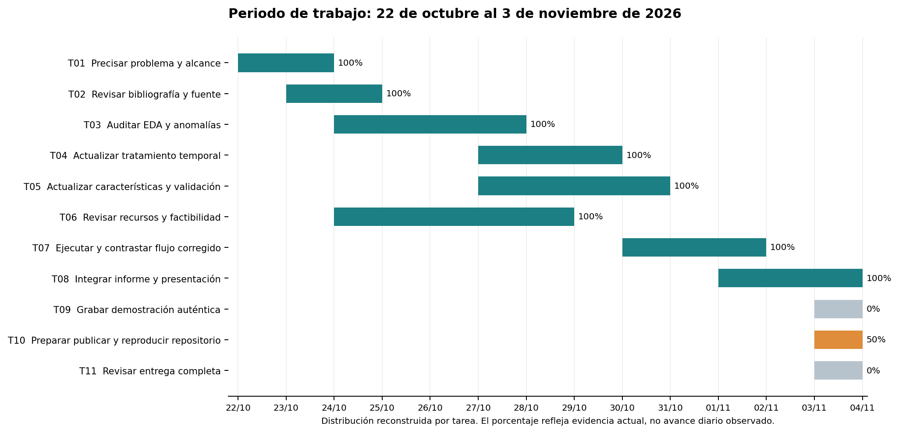
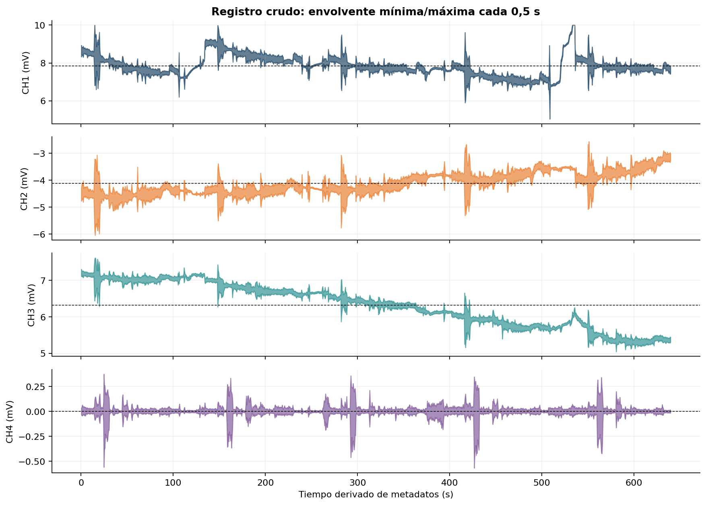
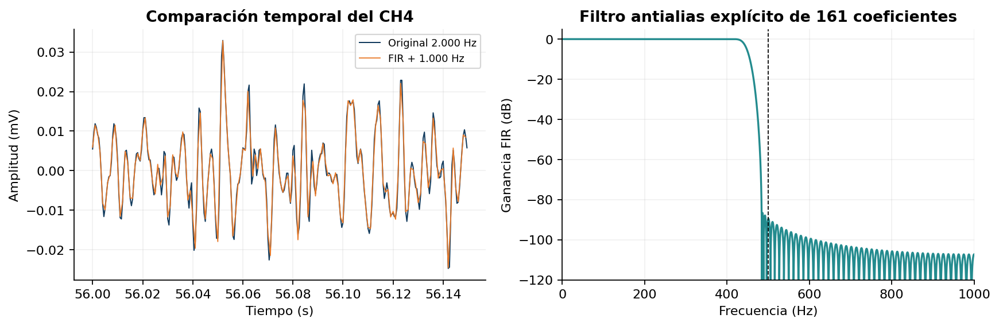
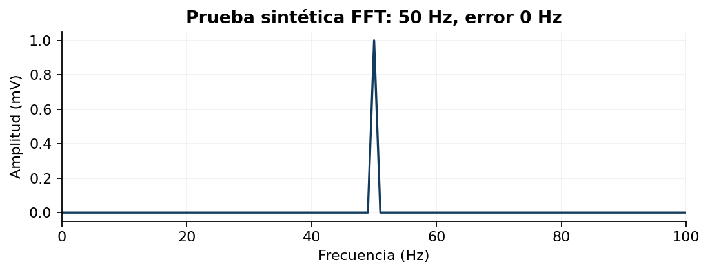
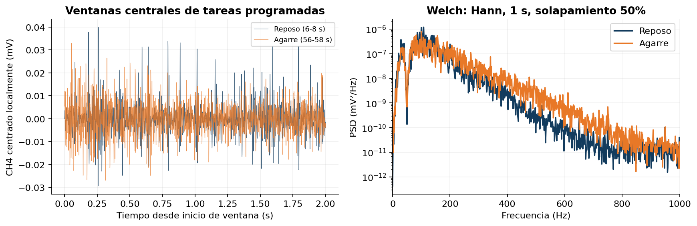
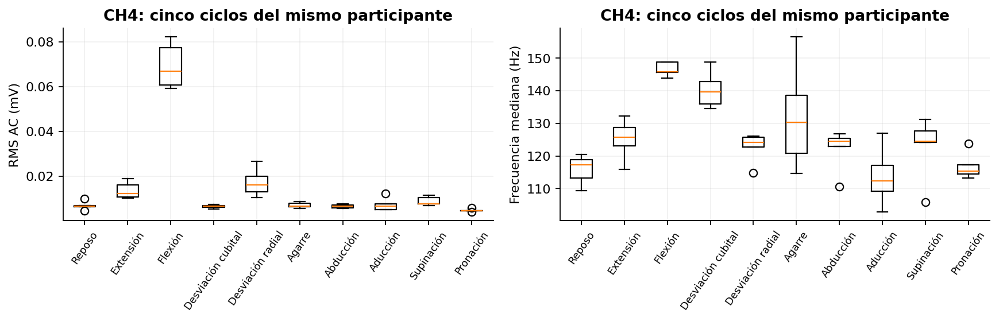

# Caracterización exploratoria de señales sEMG

UNIVERSIDAD DE SANTIAGO DE CHILE
Ingeniería Civil en Mecatrónica

Guía 3: planificación del proyecto, EDA e ingeniería inicial de características

**Registro crudo del participante 1**
Trazabilidad, calidad, prueba temporal y características por ventanas

**Autor único:** Benjamin Guzman Miranda
**Asignatura:** 92028 - Procesamiento Digital de Señales Biológicas
**Docente:** Dr. Ing. Michael Miranda Sandoval

**Periodo de trabajo:** 22 de octubre al 3 de noviembre de 2026
**Entrega oficial:** 4 de noviembre de 2026

Santiago, Chile - 3 de noviembre de 2026

---

## 1. Proyecto y planificación

**Problema técnico.** Un futuro control mioeléctrico necesita describir señales musculares reproducibles y distinguir cambios del registro de fallas de calidad. Esta etapa estudia un registro sEMG público antes de entrenar modelos o incorporar adquisición propia.

**Objetivo general.** Caracterizar un registro sEMG real mediante control de calidad y análisis temporal y espectral, como base de procesamiento para una futura entrada de control de una prótesis robótica.

**Objetivos específicos.** OE1: verificar fuente, muestreo y unidades; OE2: documentar EDA y una transformación temporal; OE3: calcular atributos por ventanas y comprobar la FFT; OE4: integrar planificación, recursos y productos reproducibles.

La matriz tactosensible de la tesis registra contacto o presión. La sEMG mide variaciones de potencial relacionadas con actividad muscular. Este avance aporta al procesamiento de una posible entrada motora y no valida el sensor táctil ni mide fuerzas.

**Figura 1.** Gantt editable en CSV y exportado. El intervalo 22-10 a 03-11 fue indicado por el estudiante. La distribución por tarea es una reconstrucción de planificación, no una bitácora diaria verificada. La entrega oficial es el 04-11 [1].

La ruta principal enlaza procedencia, calidad, características, reproducción e informe. Recursos y factibilidad pueden revisarse en paralelo. Las holguras son de planificación, no mediciones históricas. GitHub, vídeo y entrega institucional necesitan evidencia adicional; no se marcan terminados por haber llegado a la fecha prevista.

---

## 2. Recursos y trazabilidad

La modalidad con datos públicos permite evaluar el flujo computacional sin comprar sensores ni medir personas. La factibilidad técnica queda respaldada por la lectura y ejecución local. La factibilidad económica no presupone presupuesto institucional: recursos disponibles y software abierto no implican coste total cero.

| Recurso | Especificación y disponibilidad | Contingencia |
|---|---|---|
| Computador | Equipo local con Python; suficiente para 1,28 M x 4 muestras | Procesar por bloques o usar equipo institucional disponible |
| Software | NumPy, Pandas, SciPy y Matplotlib; versiones registradas | Reconstruir entorno con requirements.txt |
| Datos | Registro público 1_raw, metadatos MAT y protocolo | Recuperar versión 2 y verificar huella numérica |
| Almacenamiento | CSV local de 84,9 MB; ZIP fuente de 4,38 GB | Importar solo 1_raw.csv, sin expandir todo el ZIP |
| GitHub y vídeo | Publicación y grabación pendientes al cierre local | Completar tras revisar el paquete y comprobar acceso |

### Cotejo del registro utilizado

El CSV del trabajo coincide numéricamente con todas las muestras de **sEMG-dataset/raw/csv/1_raw.csv** del ZIP original y con la matriz **data** de **1_raw.mat**: diferencia absoluta máxima 0. Esto identifica el registro directamente. No se emplea la versión filtrada del dataset.

| Metadato confirmado en MAT | Valor |
|---|---|
| Participante / canales | 1 / 4; etiquetas originales EMG_Raw_CH1 a EMG_RAW_CH4 |
| Muestras / muestreo | 1.280.000 por canal / 2.000 Hz (Ts = 0,5 ms) |
| Amplitud / duración | mV / N/fs = 640 s; última muestra 639,9995 s |
| Origen y licencia | Ozdemir et al., Mendeley Data v2, DOI 10.17632/ckwc76xr2z.2; CC BY 4.0 [2] |

El original describe adquisición superficial del antebrazo con BIOPAC MP36 y electrodos bipolares Ag/AgCl [3]. Se preservan canales neutrales: no se verificó una correspondencia anatómica individual. El CSV no tiene timestamps independientes. El eje t=n/fs usa metadatos y no prueba continuidad previa a la exportación.

La ficha, el diccionario y las huellas SHA256 se conservan en datos/ y evidencias/. No se incluye el cuestionario demográfico. La recuperación usa el DOI y un importador que rechaza registros con distinta huella numérica. La atribución identifica autores, versión y modificaciones.

---

## 3. EDA y decisiones de calidad

La lectura explícita sin encabezados produce un DataFrame de cuatro columnas float64. No hay NaN ni valores no finitos. Se inspeccionan cuantiles, IQR, extremos, repetición de valores y rachas constantes. Se conservan los candidatos IQR, pues ser extremo no demuestra que una muestra sea errónea.

| Canal | Media (mV) | DE (mV) | Mínimo (mV) | Máximo (mV) |
|---|---|---|---|---|
| 1 | 7,850014 | 0,512513 | 5,043030 | 9,999695 |
| 2 | -4,114299 | 0,374199 | -6,040955 | -2,558594 |
| 3 | 6,322590 | 0,588581 | 5,045776 | 7,616577 |
| 4 | -0,000576 | 0,018601 | -0,568542 | 0,375061 |

**Figura 2.** Envolvente min/max de bloques de 0,5 s, solo para representación. Las estadísticas y características usan todas las muestras. El CH4 se examina en profundidad por su media próxima a cero y ausencia de rachas planas largas, sin afirmar superioridad fisiológica.

**Anomalía verificable.** El CH1 conserva 5.231 muestras exactamente iguales a 9,99969482421875 mV en [533,3845; 536) s. El registro tiene 5.398 muestras con |x| >= 9,999 mV. La meseta cercana al rango nominal +/-10 mV es compatible con recorte o pérdida de variación, sin establecer su causa electrónica.

**Decisión.** Marcar valores cercanos al riel y rachas constantes de al menos 0,1 s; preservar el original y omitir del resumen de actividad las ventanas que intersectan esa máscara. Tres de 1.280 filas quedan marcadas. La ventana [534; 536) s tiene RMS AC = 0 tras centrar: ese cero describe una señal constante y no reposo muscular.

Las reglas son exploratorias y no detectan todos los artefactos. Tampoco permiten verificar discontinuidades sin tiempos independientes. Restar una media global no obliga a que la media de cada ventana sea cero.

---

## 4. Prueba temporal y validación FFT

Se reduce el CH4 centrado globalmente de 2.000 a 1.000 Hz con resample_poly y un FIR antialias explícito: 161 coeficientes, corte de diseño 450 Hz, Kaiser beta=8,6 y extensión lineal. La banda aproximadamente conservada llega a 400 Hz; se pierde contenido próximo al límite de salida de 500 Hz. El objetivo es probar reducción de datos con pérdidas declaradas [5].

**Figura 3.** Señal real antes/después y respuesta del FIR. La prueba conserva 640 s y reduce 1.280.000 a 640.000 muestras. Las características principales continúan calculándose a 2.000 Hz.

| Versión CH4 | Muestras | fs (Hz) | DE (mV) |
|---|---|---|---|
| Original CH4 centrado | 1.280.000 | 2000 | 0,018601 |
| Remuestreo FIR antialias x2 | 640.000 | 1000 | 0,018573 |
| Selección cada 2 filas sin filtro (contraste) | 640.000 | 1000 | 0,018602 |

La potencia estimada entre 500 y 1.000 Hz representa 0,122% de la total del CH4 crudo. Aunque es pequeña, descartar filas sin filtro puede plegarla al espectro. La extensión y el FIR afectan bordes; no se atribuye toda la banda eliminada a ruido.

### Prueba sintética separada de la señal real

Una sinusoide de 50 Hz y amplitud 1 mV, fs=2.000 Hz y N=4.000, produce pico FFT de 50 Hz y error 0 Hz (paso 0,5 Hz). Hann periódica y corrección unilateral por suma de ventana recuperan amplitud 1 mV; DC y Nyquist no se duplican [6]. En otra prueba, 700 Hz se pliega a 300 Hz sin filtro al bajar a 1.000 Hz; el FIR atenúa ese tono en 104,7 dB, omitiendo bordes. Estas pruebas comprueban el código y no validan fisiología.

---

## 5. Características y comparación real

Para cada ventana no solapada de 2 s (4.000 muestras) se define y[n] = x[n] - media(x). RMS AC = sqrt(media(y²)) y MAV AC = media(|y|), ambas en mV. El centrado local define atributos de fluctuación, sin calibrar fuerza ni reparar recortes.

| Parámetro espectral | Definición utilizada |
|---|---|
| Estimador | Welch unilateral; Hann periódica; fs = 2.000 Hz |
| Subsegmento y solapamiento | 2.000 / 1.000 muestras; tres periodogramas por ventana de 2 s |
| Tendencia, escala y dominio | Retiro de media por subsegmento; density, mV²/Hz; 0-1.000 Hz |
| Frecuencia mediana | Mitad de la potencia integrada por trapecios; interpolación en integral acumulada |
| Frecuencia media | Integral(f x PSD) / integral(PSD), en Hz; bins separados 1 Hz |

Welch promedia periodogramas de subsegmentos solapados [4]. Su espaciado de bins y variabilidad dependen de esa configuración. La PSD puede incluir interferencias y deriva residual. Una frecuencia indefinida en una ventana sin variación se deja como NaN, con bandera de calidad.

Se calculan 1.280 filas por ventanas del registro completo; 1.277 superan los controles implementados. Además, el script original fija cinco ciclos con inicios 4, 138, 272, 406 y 540 s, diez tareas de 6 s cada 10 s. Se toma la ventana central [inicio+2; inicio+4) de cada tarea: 50 tareas y 200 filas canal-tarea. Son etiquetas del protocolo programado, sin confirmación cinemática.

| CH4, ciclo 1 | Ventana (s) | RMS AC (mV) | MAV AC (mV) | Mediana (Hz) |
|---|---|---|---|---|
| Reposo | 6-8 | 0,006439 | 0,004387 | 109,33 |
| Agarre | 56-58 | 0,006524 | 0,004889 | 130,41 |

**Figura 4.** Comparación a priori de reposo y agarre nominales. Sus RMS difieren aproximadamente 1,32% en estas dos ventanas. La diferencia de mediana espectral describe distribuciones de potencia, sin demostrar discriminación reproducible entre gestos.

---

## 6. Interpretación, límites y continuidad

**Figura 5.** CH4 en las ventanas centrales de cinco ciclos del mismo participante. Los cinco puntos por tarea no son participantes independientes. Los rangos expresan variación de este registro, sin inferencia poblacional.

La flexión nominal presenta mediana RMS AC de 0,066918 mV (rango 0,059132-0,082114), frente a 0,006439 mV en reposo. Es una observación exploratoria de amplitud para este canal y sujeto. La similitud reposo-agarre muestra que no todas las tareas se separan por RMS. No se realizó entrenamiento, validación cruzada ni evaluación de generalización.

**Limitaciones.** Se analiza un participante. Las tareas proceden del protocolo nominal; no hay vídeo cinemático ni fuerza sincronizada. El mapa muscular individual no está confirmado. Los canales presentan niveles medios distintos y el CH1 una meseta. La máscara es conservadora. El tiempo se deriva de metadatos. La reducción de tasa modifica banda y bordes. Estas condiciones limitan extrapolar a una prótesis y no validan la matriz táctil.

**Reproducción.** El repositorio mantiene código y datos separados, parámetros, huellas, tablas y dos notebooks. Una copia nueva local, con datos recuperados del ZIP original, ejecutó ambos cuadernos sin errores y reprodujo exactamente las tablas principales. Se reutilizó el entorno Python verificado; no se afirma instalación nueva de dependencias. El importador comprueba la versión numérica exacta.

**Repositorio público.** github.com/benjaminguzmanm-web/pdsb-semg-guia3. El estado de publicación y del clon remoto se documenta en ESTADO_ENTREGA.md. Antes de la entrega institucional faltan revisión del estudiante y vídeo real de 3-5 minutos. Para continuidad: verificar correspondencia anatómica, evaluar otros participantes y definir un protocolo independiente para la matriz de presión, sin anticipar desempeño clasificador.

### Uso de asistencia de IA

Codex/ChatGPT apoyó revisión de código, organización, comprobaciones y redacción. Se adoptaron cotejo completo del original, banderas de calidad, integración de PSD y pruebas controladas. Se descartaron causas electrónicas no demostradas y la interpretación de RMS cero como reposo. Los cálculos se ejecutaron sobre los datos; el estudiante debe revisar y explicar el método antes de entregar. La asistencia de IA no es evidencia experimental independiente.

---

## Referencias y ubicación de evidencias

[1] Miranda Sandoval, M. (2026). Guía No 3: Planificación del proyecto, análisis exploratorio e ingeniería inicial de características de señales biológicas. Universidad de Santiago de Chile, asignatura 92028. Documento del curso, octubre de 2026.

[2] Ozdemir, M. A., Kisa, D. H., Guren, O. y Akan, A. (2021). Dataset for multi-channel surface electromyography (sEMG) signals of hand gestures. Mendeley Data, versión 2. DOI: 10.17632/ckwc76xr2z.2. https://data.mendeley.com/datasets/ckwc76xr2z/2. CC BY 4.0. Consulta: 03-11-2026.

[3] Ozdemir, M. A. et al. (2022). Dataset for multi-channel surface electromyography (sEMG) signals of hand gestures. Data in Brief, 41, 107921. https://doi.org/10.1016/j.dib.2022.107921.

[4] SciPy Community. scipy.signal.welch. https://docs.scipy.org/doc/scipy/reference/generated/scipy.signal.welch.html. Consulta: 03-11-2026. La ejecución usa SciPy 1.15.3 y parámetros explícitos.

[5] SciPy Community. scipy.signal.resample_poly. https://docs.scipy.org/doc/scipy/reference/generated/scipy.signal.resample_poly.html. Consulta: 03-11-2026.

[6] NumPy Developers. numpy.fft.rfft. https://numpy.org/doc/stable/reference/generated/numpy.fft.rfft.html. Consulta: 03-11-2026.

### Archivos principales

| Evidencia | Ubicación relativa |
|---|---|
| Cotejo original y parámetros | evidencias/procedencia_verificada.json; parametros_analisis.json |
| EDA y decisiones | notebooks/01_eda.ipynb; evidencias/anomalias.csv; resumen_calidad.csv |
| Características y validación | notebooks/02_caracteristicas.ipynb; evidencias/caracteristicas_ventanas.csv; validacion_sintetica.json |
| Planificación editable | planificacion/gantt.csv; hitos.csv; materiales.csv; factibilidad.md; riesgos.md |
| Presentación y demostración | presentacion/presentacion_guia3.pdf; guion_video.md |
| Reproducción y estado de entrega | README.md; requirements.txt; evidencias/ejecucion_notebooks.json; ESTADO_ENTREGA.md |

Las fechas por tarea del Gantt no se presentan como registro contemporáneo de horas ni como historial Git. El historial local conserva las revisiones efectivas desde su creación. La publicación y la grabación pendiente se declaran en el estado de entrega.